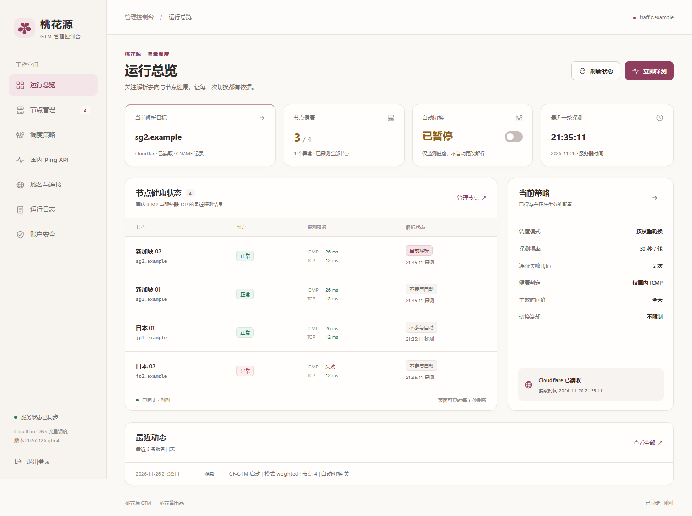
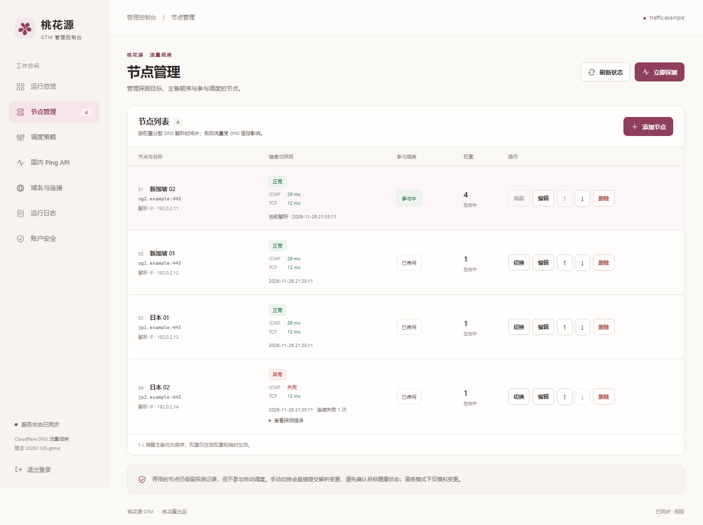
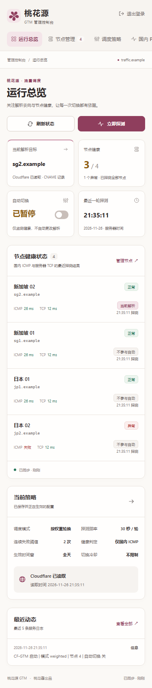

# 桃花源 GTM · Cloudflare DNS 调度控制台

> 桃花酱出品 · Telegram：[@taohuayuang](https://t.me/taohuayuang)

CF-GTM 是一个可自托管的 Cloudflare DNS 调度工具：定时检查节点健康，在故障时切换解析，或按权重时间片、多 A 记录策略管理解析去向。中文控制台集中查看节点、探测结果、DNS 状态和操作日志，配置保存在本机 JSON 文件，无需数据库。

同一仓库提供两个可独立安装的程序：

- **GTM 主控**：部署中文控制台，执行健康探测与调度，通过 Cloudflare API 修改 DNS。
- **国内 Ping API**：部署在国内服务器，从国内网络发起 ICMP 探测，将结果通过带密钥的 HTTP API 返回主控。根目录的 `cf-gtm-ping-api.sh` 已内嵌完整服务源码，只下载一个脚本即可安装。

**这是 DNS 层调度，不是连接级负载均衡。** DNS 缓存、TTL、递归解析器和客户端选址会影响实际流量；修改解析不会迁移已有连接，权重也不代表精确的请求或带宽比例。

## 界面预览

以下截图使用示例域名和演示数据。

### 运行总览



### 节点管理



### 手机端



## 功能与边界

| 能力 | 实际行为 |
|---|---|
| 主备切换 `failover` | 管理单条 CNAME 或 A 记录；当前节点连续失败达到阈值后，按节点顺序选择健康备用节点。 |
| 权重轮换 `weighted` | 管理单条 CNAME 或 A 记录；按权重分配 DNS 解析时间片，故障时选取可用节点。权重只保存在主控配置中。 |
| 多 A 记录 `round_robin` | 将健康且启用节点的 IPv4 地址组成 A 记录集合；只删除本服务创建且仍匹配的记录，保留外部记录。需要主域名使用 A 记录。 |
| 双路健康探测 | 国内 ICMP 由配置的 API 发起；本地 TCP 由 GTM 主控连接节点指定端口。支持 `api_only`、`tcp_only`、`smart` 三种判定模式。 |
| 调度保护 | 自动切换总开关、连续失败阈值、跨天时间窗、切换冷却；演练模式继续探测并记录计划，但不写入 DNS。 |
| 中文控制台 | 节点增删、排序、权重、参与调度开关、立即探测、手动切换、Cloudflare 连接检查与日志。 |
| 账户安全 | 密码与会话登录、写操作 CSRF 校验；修改密码后旧密码对应的其他会话失效。 |

国内 ICMP 不通不等于业务一定不可用，本地 TCP 成功也不能证明国内用户都能访问。`smart` 模式优先采纳本地 TCP 的明确结果，仅在 TCP 结果未知时参考国内 API；需要以国内网络为准时请选择 `api_only`（仅国内 ICMP）。

多 A 模式保留外部记录，因此外部手工创建的地址可能继续参与解析；没有健康候选时，程序保留现有解析，不清空全部记录。

## 工作方式

```text
国内 Ping API（国内服务器） -- ICMP --> 业务节点
          ^
          | HTTP(S) + token
          |
GTM 主控 --------------------- TCP --> 业务节点
    |
    | 健康判定 + 调度策略
    v
Cloudflare API --> 更新 DNS 记录
                         ^
                         | DNS 解析
                    客户端 / 递归解析器 --> 业务节点

浏览器 -- HTTPS --> GTM 中文控制台
```

主控和国内 API 可放在不同服务器；主控只需访问接口地址，不需要业务节点或国内服务器的 SSH 账号。实际探测视角取决于 API 所在网络，建议将国内 API 部署到能代表目标用户网络的国内服务器。

## 一键安装 GTM 主控

准备一台有 root 权限的 Linux 服务器。支持 Debian / Ubuntu 和 RHEL 系发行版；普通 Linux 使用 systemd，宝塔环境使用 Supervisor。主控需要 **Python 3.9+**、可用的虚拟环境，以及到 GitHub、Python 依赖源和 Cloudflare API 的网络连接。发行版提供的 Python 过旧时，请先准备满足版本要求的环境。

在服务器的 root 终端执行，先下载脚本再运行：

```bash
curl -fsSL --retry 2 https://raw.githubusercontent.com/ergou-thy/CF-GTM/main/install.sh -o /tmp/cf-gtm-install.sh && bash /tmp/cf-gtm-install.sh
```

脚本安装依赖、下载程序、生成初始配置并配置进程守护。默认端口为 `8787`；普通 Linux 默认安装到 `/opt/cf-gtm`，检测到宝塔时默认安装到 `/www/wwwroot/cf-gtm`。**新装后自动切换暂停**，先完成配置和探测，再决定是否启用调度。安装输出会给出访问方式和面板密码，请妥善保存。

自定义安装目录和端口：

```bash
CFGTM_DIR=/opt/cf-gtm CFGTM_PORT=8787 bash /tmp/cf-gtm-install.sh
```

已有安装的升级方式见下方“维护与升级”。如果服务器无法访问 GitHub Raw，可手动下载 `install.sh` 后上传执行。

### 首次配置

1. **准备 Cloudflare 凭据**：为目标 Zone 创建具有 DNS 读取和编辑权限的 API Token，记录 Zone ID；只授予所需站点权限。
2. **域名与连接**：填写 Token、Zone ID、主域名及记录类型，保存后点击“测试已保存的配置”。单记录模式要求 Cloudflare 中已有且恰好存在一条同类型主域名记录，不要混入冲突记录。
3. **节点管理**：添加业务节点的主机名或 IPv4 地址，不含协议、端口或路径；另填 TCP 探测端口。上下顺序决定主备候选优先顺序，权重只影响权重轮换模式。
4. **调度策略 → 健康探测**：设置探测来源、超时、间隔与失败阈值，先点击“立即探测”检查结果。国内 API 的安装和回填方法见下一节。
5. **启用调度**：检查调度模式、时间窗与冷却。需要验证计划时，先开启演练模式，再开启自动切换并观察日志；确认后关闭演练模式，开始实际 DNS 调度。

自动切换关闭只暂停自动 DNS 调度，仍可探测。手动切换会提交 DNS 变更，不受自动时间窗和冷却限制；演练模式下手动切换也只模拟。

## 一键安装国内 Ping API

在**国内服务器**的 root 终端执行，与主控安装命令分开运行：

```bash
curl -fsSL --retry 2 https://raw.githubusercontent.com/ergou-thy/CF-GTM/main/cf-gtm-ping-api.sh -o /tmp/cf-gtm-ping-api.sh && bash /tmp/cf-gtm-ping-api.sh
```

国内 API 支持运行 systemd 的 Debian / Ubuntu 和 RHEL 系 Linux，使用 Python 3 标准库与系统 Ping，无需 pip、数据库或额外源码下载。默认监听 `0.0.0.0:8788`，服务名为 `cf-gtm-ping-api`，由独立低权限账号运行。

安装时填写国内服务器公网主机名及可选的主控来源 IP/CIDR 白名单。所有 `/ping` 请求都必须提供 token，白名单不能代替密钥。只允许公网单播 IP，或解析结果全部为公网 IP 的域名；不接受内网目标、URL、附带端口或 shell 参数。

完成后，将脚本实际输出的完整地址填入 GTM 的“调度策略 → 健康探测 → 国内探测接口”：

```text
http://国内服务器:8788/ping?host={target}&token=安装时生成的密钥
```

- 保留 `{target}` 原样；也兼容 `url={target}`，`host` 和 `url` 只能选一个。
- 健康判定选 **仅国内 ICMP（`api_only`）**，单次超时建议 **至少 6 秒**。
- 保存后先点击“立即探测”，确认结果再启用自动调度。
- 防火墙及云安全组只允许主控访问 `8788`；脚本不会自动开放端口。公网使用建议加受信任的 HTTPS 反向代理，避免 token 明文传输。

详细环境变量、更新、日志与卸载说明见 [国内 Ping API 部署说明](DOMESTIC-PING-API.md)。控制台“国内 Ping API”页也提供脚本下载；仓库 `tools/install-ping-api.sh` 与根目录 `cf-gtm-ping-api.sh` 为同一单文件脚本的下载副本，无需向控制台提供服务器 SSH 账号。

## 关键配置

日常管理优先使用控制台。`config.json` 保存实际配置，`state.json` 保存运行状态及多 A 记录所有权；升级和迁移时应一并备份。

| 配置键 | 说明 |
|---|---|
| `cloudflare.api_token` / `zone_id` | Cloudflare API 凭据；控制台留空 Token 会保留已保存值。 |
| `cloudflare.record_name` / `record_type` | 主域名与 `CNAME` 或 `A` 类型。多 A 模式只支持 `A`。 |
| `probe.interval_seconds` | 每轮结束后的等待间隔，最少 10 秒，通常可从 30～60 秒起步。 |
| `probe.timeout_seconds` | 单次探测超时，3～60 秒；独立国内 API 建议至少 6 秒。 |
| `probe.fail_threshold` | 连续失败阈值，1～10 次。 |
| `probe.decision_mode` | `api_only` 仅看国内 API；`tcp_only` 仅看主控 TCP；`smart` 为 TCP 优先。 |
| `probe.api_url` | HTTP/HTTPS 探测接口模板，必须保留 `{target}`。 |
| `probe.record_ttl` | DNS TTL：`1` 为自动，或 `60`～`86400` 秒；最终可用值受 Cloudflare 规则约束。 |
| `nodes[].target` / `port` | 节点主机名或 IPv4 地址、TCP 探测端口。 |
| `nodes[].weight` / `enabled` | 权重 `1`～`1000`；是否参与自动调度。 |
| `mode` | `failover` / `weighted` / `round_robin`。 |
| `scheduler.slice_seconds` | 权重轮换时间片，30～86400 秒；按探测轮次检查是否到期。 |
| `auto_switch` | 自动 DNS 调度总开关。 |
| `auto_window` | 自动调度时间窗，按服务器时区，支持跨天。 |
| `cooldown_minutes` | 自动切换最短间隔，`0` 表示不限制。 |
| `dry_run` | 演练开关；只记录计划，不写入 DNS。 |
| `web.host` / `port` / `password` | 控制台监听地址、端口、密码。 |

### 其他探测接口与旧例

默认配置仍兼容第三方接口模板：

```text
https://v2.xxapi.cn/api/ping?url={target}
```

第三方服务的可用性和限额由其提供方决定。主控将 `code=200` 视为探测成功、`code=-2` 视为探测失败，其他结果视为未知；“仅国内 ICMP”模式下，未知结果也不算健康。

旧版 `probe-server/` TCP 探针示例保留供已有部署参考，不作为新装推荐。它的旧接口形式如下；这类 TCP 结果不应当作本仓库独立 API 的国内 ICMP 结果：

```text
http://国内服务器:8080/ping?host={target}
```

新部署请使用上面的 `cf-gtm-ping-api.sh` 和 [独立部署说明](DOMESTIC-PING-API.md)。

## 维护与升级

### 主控升级

先备份安装目录中的 `config.json`、`state.json` 及自己修改的部署配置，再下载新版脚本并使用 `--update`：

```bash
curl -fsSL --retry 2 https://raw.githubusercontent.com/ergou-thy/CF-GTM/main/install.sh -o /tmp/cf-gtm-install.sh && bash /tmp/cf-gtm-install.sh --update
```

自定义安装目录时，升级应传入同一个 `CFGTM_DIR`：

```bash
CFGTM_DIR=/opt/cf-gtm bash /tmp/cf-gtm-install.sh --update
```

升级保留现有配置、节点和凭据。升级后检查服务、登录、探测结果、已保存的调度开关及 Cloudflare 连接；不要用示例配置覆盖自己的 `config.json`。迁移多 A 模式时保留 `state.json`，避免丢失已创建记录的所有权信息。

普通 Linux 的常用命令：

```bash
systemctl status cf-gtm --no-pager
journalctl -u cf-gtm -n 50 --no-pager
systemctl restart cf-gtm
curl -fsS http://127.0.0.1:8787/login -o /dev/null
```

宝塔环境在 Supervisor 管理器查看和重启 `cf-gtm`。反向代理可参考 [`deploy/nginx.conf.example`](deploy/nginx.conf.example)；手动进程守护模板见 [`deploy/`](deploy/)。国内 API 更新时重新执行它自己的安装命令，默认保留原 token、端口与来源限制，详见 [维护说明](DOMESTIC-PING-API.md#维护与卸载)。

## 安全建议

- 安装完成后修改并妥善保管面板密码；使用 HTTPS 访问控制台，按需要增加访问白名单。
- 主控 `8787` 建议仅监听 `127.0.0.1`，通过同机反向代理提供 HTTPS；如临时直连调试，只允许自己的管理来源访问。
- 国内 API `8788` 只向主控开放。若使用 HTTPS 反代，还应限制后端端口，避免绕过代理；来源白名单按服务看到的真实连接来源校验，不信任转发头。
- `config.json`、`state.json`、备份文件及含 token 的 API 地址均应按敏感信息保护；不要公开面板密码、Cloudflare Token、API 密钥或完整带密钥 URL。
- Cloudflare Token 只授予目标 Zone 所需权限。DNS 调度记录与面板访问域名分开规划，修改前确认记录类型与现有记录。
- 同一份配置只启动一个主控调度进程，避免多个实例同时写入 DNS；自行扩展 WSGI 部署时也应明确初始化与后台调度的归属。

## 目录与文件

```text
.
├── app.py                    # GTM 主控后端
├── install.sh                # 主控安装与升级
├── cf-gtm-ping-api.sh         # 国内 Ping API 单文件安装器（内嵌源码）
├── DOMESTIC-PING-API.md       # 国内 API 操作说明
├── templates/                # 中文控制台与登录页
├── static/                   # 本地样式、脚本与图标
├── tools/                    # 控制台提供的 API 脚本下载副本与源码
├── deploy/                   # systemd / Supervisor / Nginx 示例
└── probe-server/             # 旧版 TCP 探针示例（兼容参考）
```

运行时另生成 `config.json`、`state.json` 和日志文件，不应将实际运行配置提交到公开仓库。旧版探针示例保留兼容参考，主控与新国内 API 的安装互相独立。

## 验证范围

本轮在 Windows / Python 3.12 上使用当前发布文件完成隔离核验：主控后端 **89 项全部通过**；国内 API 当前适用的 **67 项测试中 66 项通过、1 项跳过**，另有 **4 项内嵌源码与摘要一致性检查通过**；主控安装器 **29 项测试中 23 项通过、6 项跳过**。测试不调用真实 Cloudflare、国内探针或生产服务。

历史已有 **150 项 UI 检查、76 项国内 API Linux 隔离测试**通过记录，本轮未重跑。本机没有 Bash，主控安装器的 Bash 语法、完整 systemd / Supervisor 安装和失败恢复流程未在 Linux 上执行；Windows 不支持的权限及符号链接场景按实际情况跳过。旧版“从 GTM 下载 Ping API 源码”的静态断言已不适用于当前内嵌单文件实现，未计入本轮适用测试。

这些结果不代表已在所有发行版、宝塔版本或真实国内服务器完成部署。实际安装后仍需验证本机服务、国内公网连通性、来源限制、Cloudflare 权限与 DNS 缓存行为；本文不承诺固定切换耗时。

## 常见问题

**为什么切换后还有流量到旧节点？** 解析器和终端可能仍有缓存，已有连接也不会随 DNS 修改迁移。切换时延由探测耗时、间隔、失败阈值、时间窗、冷却及 DNS 缓存共同决定。

**为什么国内 Ping API 显示未知？** 先检查 API 服务、防火墙、token 和来源白名单，再查 Ping 权限与目标是否为公网地址。接口解析、权限或系统错误会返回未知，不会伪装成一次明确的 ICMP 丢包结论。

**为什么多 A 模式没有删掉手工添加的地址？** 程序只删除自己创建且仍匹配的记录；外部记录需要管理员自行确认和管理。没有健康候选时也会保留现有记录。

**Cloudflare 连接检查失败怎么办？** 核对 Token、Zone ID、主域名及记录类型，确认主控能访问 Cloudflare API；单记录模式还需排除同名冲突或重复记录。

## License

MIT
